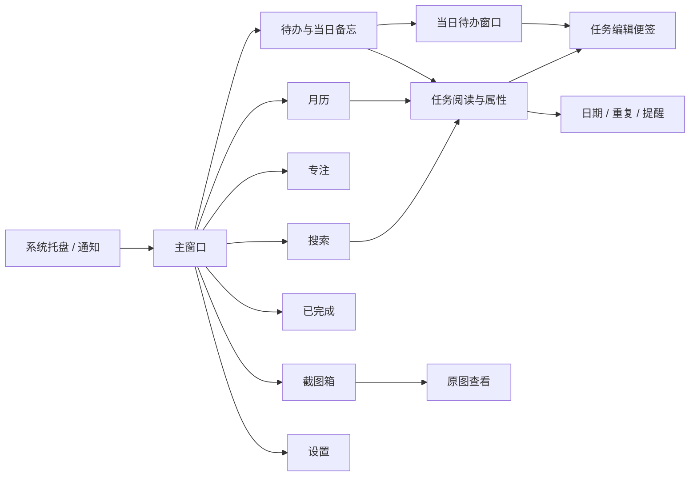

# 现状审计

基线 `e96f50e`，2026-10-13。结论来自当前代码、隔离示例数据上的控件渲染及现有验证工具。用户画像为根据本次长期对话归纳的设计假设，未进行外部用户访谈。

## 1. 产品与用户

核心用户是 Windows 上长期工作或学习、需要随手记录的个人用户。已知偏好是轻量常驻、少打断、带一点可爱感、笔记可直接编辑，便签能置顶并使用个人背景。截图中的学习材料与任务计时表明“看资料 → 摘要 → 专注 → 次日继续”是重要场景；这不等于产品只面向程序员。

主要任务按频率推断如下：

| 场景 | 用户要完成什么 | 当前路径 | 设计要保留的结果 |
| --- | --- | --- | --- |
| 早晨安排 | 看今天任务、补充一项 | 待办 → 日期 → 底部输入 → 添加 | 快速创建，默认安排到当前日期 |
| 工作中记笔记 | 将内容留在任务旁 | 选任务 → 主界面只读预览 → 打开便签 → 直接输入 | 文档快捷键、500 ms 合并保存、失焦补存 |
| 边做边计时 | 记录真实投入 | 主界面“开始专注”转专注页；便签按钮直接开始 | 同一任务关联、暂停不计时、单会话 |
| 多天推进 | 今天先结束，明天继续 | 日期与推进 → 持续推进；⋯ → 今天先到这里 | 保留同一任务 ID、笔记、附件和计时历史 |
| 当天清单常驻 | 桌面边缘查看待办 | 弹出当日待办 → 双击任务 → 专属便签 | 两种窗口职责清楚，均可置顶 |
| 临时资料 | 截图、粘贴、回看原图 | 快捷键 → 剪贴板 / 截图箱 → 双击原图 | 明确自动清理日期和另存入口 |
| 回顾 | 找某天的记录或已完成任务 | 月历 / 完成 / 搜索 → 定位任务 | 完成日、推进日与安排日保持真实语义 |

“完成任务”和“今天先到这里”是两种不同的结束动作，界面必须解释清楚。截图箱是临时存储，也应显著区分“暂存”和“另存为”。

## 2. 项目结构与页面入口

这是 `.NET 10 + WPF + SQLite` 的桌面程序。没有 Web Router、URL 路由或 SPA 页面树。主窗口通过 `Visibility` 与选中状态切换页面，窗口和页面内的状态由代码后台维护。

| 层级 / 文件 | 当前职责 | 设计影响 |
| --- | --- | --- |
| `App.xaml.cs` | 单实例、托盘、提醒、截图与专注服务、程序生命周期 | 关闭隐藏、托盘退出、通知跳转必须保留 |
| `MainWindow.xaml` / `.xaml.cs` | 导航、待办、月历、搜索、完成、设置及显示状态 | 页面布局与交互代码耦合，重构宜分页面逐步验证 |
| `MainWindow.Focus.cs` / `.Planning.cs` | 专注入口、跨日状态与多窗口同步 | 新外观不能复制任务或改变日期规则 |
| `DailyTodoWindow` | 某天的任务清单、完成、推进、打开任务笔记 | 需要窄宽度下稳定的任务行与操作区 |
| `TaskNoteWindow` / `NoteAppearance.cs` | 独立编辑便签、全局背景、透明度、图钉样式 | 全局外观作用范围要在面板中说清楚 |
| `MarkdownNoteView` / `NoteOutlinePanel` | 原生阅读、目录、源码兼容模式 | 主体只读，便签负责编辑；布局一致性重要 |
| `DocumentNoteHost*` / `EditorWeb/` | WebView2 与 Vditor、文档桥接、保存与恢复 | 网页正文和原生外壳是两套样式技术，需要共享设计值 |
| `FocusPage` / `FocusBar` | 番茄钟、正计时、当日投入、历史 | 时间与状态要优先，统计不能混成任务完成进度 |
| `ScreenshotPage` / `ScreenshotViewer` / `ScreenshotSettingsView` | 临时截图、原图、清理与快捷键 | 选中状态、到期信息、批量操作应更清楚 |
| `TaskPlanWindow` / `RepeatRuleWindow` | 安排、截止、持续推进、重复规则 | 属性编辑应集中，保持规则互斥及无边框拖动 |
| `Styles/SharedStyles.xaml` / `LiveStyleDictionary` | 公共画刷、按钮、输入框及开发热加载 | 已有可复用基础，但页面内仍有许多硬编码样式 |
| `DiaryRepository*` / `FocusStore` / `ScreenshotStore` | 持久化与业务规则 | 本次设计不改变这些行为 |

页面入口：待办、日历、专注、搜索、完成、截图、设置。专注在主窗口的生产构造器中注入；通用预览工具未注入专注服务，因此部分证据图的侧栏没有“专注”。这是采集条件，不能据此判定入口缺失。

导航关系：

## 3. 实际界面采集

运行了现有 `tests/Preview`、`tests/FocusUI`、`tests/Screenshots` 和 `tests/NoteAppearance`。它们使用独立示例数据库。主页面由当前 WPF 控件的 Measure / Arrange / RenderTargetBitmap 导出，便签使用位于屏幕外、`ShowActivated=false` 的真实透明窗口与 WebView2。没有操作运行中的正式日记。

| 证据 | 尺寸 / 类型 | 用于判断 |
| --- | --- | --- |
| [标准待办](evidence/home-standard.png) | 1100 × 720，当前控件渲染 | 空间分配、嵌套滚动与主次层级 |
| [窄屏待办](evidence/home-compact.png) / [详情](evidence/home-detail.png) | 760 × 580 | 列表与详情切换、垂直拥挤 |
| [宽屏待办](evidence/home-wide.png) | 1500 × 900 | 日期栏占用、留白和三栏比例 |
| [标准月历](evidence/calendar-standard.png) / [窄屏月历](evidence/calendar-compact.png) | 1100 / 760 宽 | 任务截断、滚动与整月可读性 |
| [专注](evidence/focus.png) | 920 × 780，独立真实控件 | 计时、统计、历史关系 |
| [便签编辑器](evidence/sticky-live.png) | 400 × 600，真实 WebView2 | 简约外观、编辑工具栏与保存反馈 |
| [小待办便签](evidence/daily-small.png) | 285 × 290 | 小窗口可操作空间 |
| [截图箱](evidence/screenshots.png) / [设置](evidence/settings.png) | 1100 × 720 | 大缩略图、批量操作、表单尺寸 |
| [搜索](evidence/search.png) / [完成](evidence/completed.png) | 1100 × 720 | 辅助页面一致性与信息密度 |

来源详见 `evidence/manifest.json`。便签测试会插入“自动保存验证”，背景也是测试生成图；截图瞬间的“保存中…”不能证明生产保存异常。不同工具会添加不同的示例任务，计数不用于业务正确性对比。

Playwright 使用本机 Chrome 无头浏览器检查证据画廊和方案原型。浏览器无法直接访问 WPF 主窗口的视觉树；本轮没有桌面 UI 自动化、Windows 高 DPI 实机、读屏器、多屏拖动或计时延迟测量。这些限制应在落地验收时补齐。

## 4. 现状评价

### 信息架构：功能覆盖完整，操作层次需要收敛

任务、当天备忘、任务笔记和临时截图有清楚的数据归属；侧栏已避免把所有功能堆在主页。问题是任务属性仍散布于“日期与推进”、提醒输入、重复按钮以及 ⋯ 菜单；低频“删除此任务”与高频“打开便签”使用相近的视觉重量。专注在便签与主窗口的行为不同，标签应说明“直接开始”或“进入专注设置”。

### 布局：固定高度区域挤压主要工作

在标准证据图中，已展开的旧任务区、底部添加框和今日备忘使今日清单只能完整显示一条任务，剩余内容需滚动。宽屏虽然增加日期栏，但新增面积没有全部用于任务和阅读。窄屏切换为单栏是正确方向，仍需降低标题、输入区和容器边距的固定占用。

### 视觉层次：品牌统一，但过多控件争夺注意力

暖纸色、棕色文字、薄荷绿易于识别。胶囊、厚边、底部投影、大圆角同时用于导航、输入、按钮、任务行和容器，层级变得模糊。高饱和黄色备忘比当前任务更醒目；亮青色滚动条会成为视觉焦点。应将主要强调留给当前任务、当前计时与一次明确的主操作。

### 组件一致性：主窗口与便签已形成两个系统

主窗口是暖色立体控件，便签是冷灰透明纸面与细线图标。`SharedStyles.xaml` 已提供基础，但各页面仍有局部颜色、间距与按钮实现。后续用户确认喜欢现有任务便签，因此保留这一区别；仅整理主窗口及相关页面的样式，不将新主题传播到 `TaskNoteWindow` 或 `EditorWeb/island.css`。

### 反馈：数据保护充分，视觉可发现性仍不足

自动保存、失焦补存、找回副本、任务完成归档、截图清理日期和真实计时都已存在。应将这些结果转为稳定的小范围反馈：保存失败保留可点击提示，保存成功避免反复闪动；收起任务后显示“已移到今日已推进”；整个任务完成使用清晰文字，而非仅靠颜色。新增撤销提示若需要业务支持，应先验证已有恢复接口和时间范围，不在本轮承诺数据撤销栈。

### 可访问性：存在可量化的对比度风险

按源码颜色计算，次要文字 `#9F927D` 在 `#F8F8F0` 上约 **2.86:1**，白字在薄荷主按钮 `#19C8B9` 上约 **2.10:1**，均低于普通文本常用的 4.5:1 目标；正文棕色在纸面上约 **6.01:1**。计算不包含透明背景、抗锯齿和禁用控件，详见 `contrast.json`。

若干共享按钮取消了 `FocusVisualStyle`；输入框有焦点边框，但键盘遍历按钮的可见性不能由此保证。建议恢复细而明确的键盘焦点，不恢复用户不喜欢的粗黄色轮廓。主要交互建议至少 32 DIP 命中区域，视觉图标可以保持 16～20 DIP。

### 响应式：已有真实断点，仍有内容密度问题

现有宽度断点为 1000 / 1400 DIP，主窗口最小 760 × 580；没有整体 Viewbox 缩放。这是可保留的基础。窄月历在证据中仅显示部分周数、任务频繁省略，适合增加日清单辅助阅读或切换为月历加选中日明细。注意：此处是呈现建议，不新增周计划、拖拽排程等业务能力。

### 维护与性能：优先整理原生视图与语义资源

仍应以 WPF 作为主壳，继续按需加载笔记 WebView2。不要为了统一样式把所有页面改成浏览器实例。布局切换保留选中任务、滚动、输入法和计时状态；WebView2 的隐藏与释放约定也不能因动画被破坏。当前没有本轮性能测量，不能声称某方案已降低 CPU 或内存。

## 5. 优先问题与可验证目标

| 优先级 | 问题 | 推荐设计目标 | 验证方法 |
| --- | --- | --- | --- |
| 高 | 今日任务可见空间不足 | 标准 1100 × 720、包含旧任务与备忘时至少完整看到 5 条普通任务 | 相同示例数据对比，不靠减小正文字号 |
| 高 | 辅助文字与主按钮对比不足 | 正常文本达到 4.5:1；图标与边界按用途检查 | 计算颜色并检查实际背景 |
| 已约束 | 主窗口与便签风格不同 | 用户选择保留任务便签，不要求强行统一 | 回归确认主窗口主题不改变便签 |
| 中 | 属性操作分散、删除权重过高 | 日期、重复、提醒归入一致属性区；低频操作收进菜单 | 按给定任务路径完成场景测试 |
| 中 | 跨日状态难以理解 | 标签明确“持续推进”“今日已推进”“已完成” | 不依赖颜色也能辨别三种状态 |
| 中 | 月历窄屏截断严重 | 月格保留日期和计数，选中日列表显示完整标题 | 760 × 580、六周月、长中文任务 |
| 中 | 背景透明影响可读性 | 文本不透明，预览同时显示深浅桌面效果 | 有图 / 无图 / 最低透明度的对照 |
| 中 | 键盘焦点不明显 | 全部交互可见焦点与顺序，不抢编辑焦点 | Tab / Shift+Tab / Esc / Enter、IME |
| 低 | 旧设计文档与实现不一致 | 新规范以代码和证据为准，落地时同步更新旧文档 | `DESIGN.md` 仍含旧便签风格及旧月历描述 |

本轮没有修复上述问题；它们构成三套设计探索和后续验收的输入。
